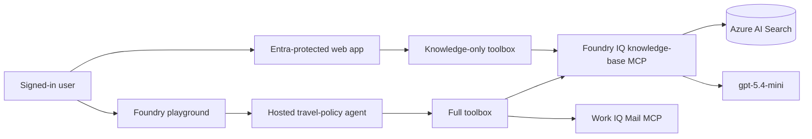

# Foundry IQ Travel Policy Demo

A complete Microsoft Foundry IQ demonstration grounded in corporate travel
policies. The solution deploys:

- a dedicated Microsoft Foundry account, project, and `gpt-5.4-mini` model;
- an Azure AI Search Basic service with a travel-policy index, knowledge source,
  and answer-synthesizing knowledge base;
- a hosted Agent Framework agent that combines Foundry IQ with Work IQ Mail;
- a tenant-protected FastAPI web chat that demonstrates Foundry IQ only;
- managed identity, RBAC, Application Insights, Log Analytics, and Key Vault.

## Architecture



The hosted-agent experience uses the caller's identity for Work IQ Mail. The
web experience intentionally uses only standing policy because its managed
identity does not forward the user's Microsoft 365 token.

## Source content

`knowledge/travel-policies.json` contains ten policies covering approvals,
airlines, hotels, expenses, international travel, ground transportation, and
cancellations. `provision_kb.py` validates the JSON, creates the Search schema,
uploads the policies, and creates the Foundry IQ knowledge source and knowledge
base.

## Prerequisites

- Azure CLI and Azure Developer CLI authenticated to the target tenant.
- `azd` with the `microsoft.foundry` extension bundle.
- Python 3.13 and `uv`.
- Permission to create Azure resources, role assignments, and a tenant app
  registration.
- A Microsoft 365 Copilot-enabled user for the Work IQ portion of the demo.

## Deployed personal-tenant environment

| Setting | Value |
|---------|-------|
| Environment | `foundryiq-personal` |
| Tenant | `8317facd-c013-4d0c-9998-ff8d29c7f379` |
| Subscription | `ME-MngEnvMCAP091599-virouet-1` (`28d00f59-8f5a-4c76-9b68-a214688e996b`) |
| Region | `francecentral` |
| Resource group | `rg-foundryiq-personal` |
| Model | `gpt-5.4-mini` |
| Web app | `https://app-fiq-agi2xio4.azurewebsites.net/` |
| Hosted agent | `https://cog-agi2xio4nmgfs.services.ai.azure.com/api/projects/foundryiq-personal/agents/travel-policy-agent/endpoint/protocols/openai/responses?api-version=v1` |
| Foundry playground | `https://ai.azure.com/nextgen/r/KNAPWY9aTHabaKIUaI6Zaw,rg-foundryiq-personal,,cog-agi2xio4nmgfs,foundryiq-personal/build/agents/travel-policy-agent/build?version=1` |

The original `foundryiq-demo` deployment in the FDPO tenant remains deployed
and billable until it is explicitly removed.

## Deploy

Provisioning creates billable resources, RBAC assignments, a Work IQ
connection, and an Entra application for web authentication.

```powershell
$env:AZURE_DEV_USER_AGENT = "microsoft_foundry_skill"
azd provision --no-prompt
azd deploy --no-prompt
```

The post-provision hook:

1. provisions the policy index, knowledge source, and knowledge base;
2. creates the project-managed-identity Search MCP connection;
3. creates the user-identity Work IQ Mail connection;
4. creates `knowledge-base` and `travel-policy-full` toolboxes;
5. configures tenant-only App Service Authentication.

## Demo

Open the `SERVICE_WEB_URI` reported by `azd` and ask:

- What's the maximum domestic hotel rate?
- Who approves a $3,500 domestic trip?
- When is an expense report due?
- Can I fly business class on an eight-hour flight?

Invoke the full hosted agent:

```powershell
azd ai agent invoke "What's the travel budget for New York?"
```

In the Foundry playground, the agent searches both the standing-policy
knowledge base and Work IQ Mail. Work IQ results depend on the signed-in user's
mailbox and licensing.

## Local checks

```powershell
uv run --no-project --with azure-identity --with python-dotenv --with requests python --version
python -m unittest discover .\src\agent-framework-foundry-iq-knowledge-base-responses\tests

python -m pip install -r .\src\web\requirements-dev.txt
python -m pytest .\src\web\tests

az bicep build --file .\infra\main.bicep
```

## Security

- Search and Foundry local authentication are disabled.
- Search, Foundry, toolboxes, and the web app use Entra identities.
- App Service is HTTPS-only and protected by tenant-only Easy Auth v2.
- Work IQ uses per-user Entra passthrough.
- The web-auth client secret is generated with a 29-day lifetime (within the
  tenant's 30-day policy), stored in the slot-sticky
  `MICROSOFT_PROVIDER_AUTHENTICATION_SECRET` App Service setting, referenced
  by Easy Auth v2, and never committed.

## Cleanup

Review the selected environment, then remove billable Azure resources:

```powershell
azd down
```

Delete the Entra application named `foundryiq-demo-web-foundryiq-personal`
separately if it is no longer needed.
